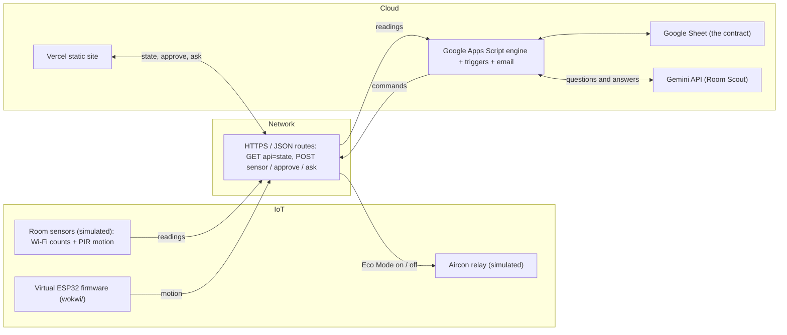

# GhostRoom

**APSpace shows what is scheduled. GhostRoom shows what is true.**

- A "ghost room" is booked on the timetable but empty, with the aircon still on. Students are told it is taken.
- GhostRoom compares APU's real timetable with live room occupancy (simulated Wi-Fi device counts and motion sensors) and marks each room: in use, free, ghost, or sensor offline.
- It emails a waste report every morning with nobody clicking. One Approve click sets the (simulated) aircon back, and motion in the room brings it back.

- **Live demo:** https://ghostroom-mu.vercel.app
- **Video:** [FILL: video URL]
- **Team:** [FILL: team names and roles]

Track 1, Smart Campus & Student Experience. APU Cloud Innovation Hackathon 2026, theme "When Cloud, IoT, and Network Converge".

## What you can try in 60 seconds

Open https://ghostroom-mu.vercel.app

1. In the 3D campus model, click **Block B** or **Block D**. The block opens floor by floor. Click a room tile and the room opens as a cutaway. (Drag to turn the model. **Flat** shows the same rooms as plain elevations, and is what phones get.)
2. Read the two lines: **Timetable says** (what is booked) and **Sensors say** (what is really there).
3. Use the **Ask Room Scout** box at the top. The first starter question follows the room you picked: "I am near D-07-08. Where is the closest room to study undisturbed?" It answers only from the live rows.
4. Eco Mode needs a ghost room. Click **A ghost room** under the building, then **Turn on Eco Mode**: the air in the drawing stops and the room turns green. Then click **Walk in**: motion comes back and the aircon returns.
5. If no room is a ghost at that moment, that is normal (real timetable, simulated people). Try again later, or see "Run it yourself" for demo mode.

## Architecture



- Readings go up: sensors send Wi-Fi counts and motion over HTTPS/JSON to the Apps Script web app.
- The engine writes every result to the Google Sheet. The Sheet is the contract between all parts.
- Commands go down: an Approve (or a `RELEASE`) becomes a row in `commands`, and the relay state follows.
- The Vercel site only reads state and sends clicks. It holds no keys. Room Scout calls the Gemini API from Apps Script.

## How it works

| Rule | Value |
|---|---|
| Ghost room | Booked on the timetable and empty for 20 minutes |
| Sensor offline | No heartbeat for 15 minutes. Never called free, never set back |
| Eco Mode | One click by a person sets a ghost room's aircon back (the back end calls this `SETBACK`) |
| Motion | Always overrides Eco Mode and turns the aircon back on |
| Recompute | Every 5 minutes (`tick`). State is a pure function of time, timetable, seed and overrides, so a missed tick corrupts nothing |
| Morning brief | Email at 07:30 (Google runs it within about 15 minutes of that), every run logged in `runs` |

**Sheet tabs**

- `config` — settings: seed, demo scenario, ghost rate, kW per room, tariff.
- `rooms_live` — one row per room: booking, people, Wi-Fi clients, aircon, status.
- `free_now` — rooms that are really free, and until when.
- `ghost_now` — current ghost rooms, minutes empty, estimated kWh and RM.
- `commands` — Approve / release requests (`PENDING` then `DONE`).
- `daily_stats` — per-day totals used by the morning brief.
- `gym_live` — small gym busyness panel.
- `runs` — a log of each timer run (proof it ran alone).

**Web app routes** (Apps Script web app, `/exec` URL)

- `GET ?api=state` — JSON of all rooms and counters.
- `POST {type:"sensor", room, motion}` — a motion reading (counts as "someone is here" for 10 minutes).
- `POST {type:"approve", room}` — set back a ghost room.
- `POST {type:"ask", text}` — Room Scout answer.

POST bodies are sent as `text/plain` so the browser needs no preflight.

## What is real and what is simulated

| Real | Simulated |
|---|---|
| APU's public timetable feed: 60 rooms in Blocks B and D, 3,201 sessions, lecturer and student identifiers stripped | Occupancy: a seeded simulator stands in for Wi-Fi counts and PIR sensors |
| The rules engine (ghost, offline, Eco Mode, motion override) | The aircon relay: no real APU equipment is touched |
| Unattended runs: the 07:30 email ran by itself on 10, 11 and 12 Nov | Energy and RM figures: a model of 3.5 kW per room, RM 0.365/kWh, and an Eco Mode setback that saves about 60% |
| The Gemini-backed chat, grounded on live rows | |

## Prototype now, Gemini Enterprise for finals

The prototype rules do not require Gemini Enterprise. The finals product will use it. The Sheet stays the same, so only the "brain" is swapped. Nothing for Gemini Enterprise is built yet.

| Job | Prototype (today) | Finals (planned) |
|---|---|---|
| Room Scout: "find me a free room" | Chat box calling the Gemini API, answering only from live `rooms_live` / `free_now` rows | Gemini Enterprise chat agent reading the same tabs |
| Morning Brief: daily waste report | Apps Script timer at 07:30, email to the owner | Gemini Enterprise scheduled workflow |
| Ghost Patrol: approve, then aircon off | Approve button writes a row to `commands` | Gemini Enterprise workflow with a human Approval step, writing the same row |

## Run it yourself

1. **Sheet and Apps Script:** follow [`apps-script/DEPLOY.md`](apps-script/DEPLOY.md) (about 15 minutes, no billing). It covers pasting `Code.gs`, `Timetable.gs` and `dashboard.html`, running `setup()`, and deploying the web app.
2. **Gemini key:** the key lives only in Apps Script **Script Properties** as `GEMINI_API_KEY`. It is never in the repo. Without it, the chat says Room Scout is not set up and nothing else breaks.
3. **Website:** put your web app URL in the `API` const at the top of `web/app.js`. The site is static (no build step). Run it locally with `python3 -m http.server 5178 --directory web`, then open http://localhost:5178. Deploy with `cd web && vercel deploy --prod --yes`.
4. **Self-test** (plain Node, no install):
   ```bash
   node scripts/run-selftest.mjs
   ```
5. **Refresh the timetable** (fetches APU's public feed, strips identifiers, rewrites `data/timetable-snapshot.json` and `apps-script/Timetable.gs`; paste the new `Timetable.gs` into Apps Script again):
   ```bash
   node scripts/fetch-timetable.mjs
   ```
6. **Demo mode:** in the Sheet's `config` tab set `demo_scenario` to `demo`. Within 5 minutes `D-07-08` is a ghost, `B-05-03` is squatted and `B-08-01` is offline (demo bookings are 2 hours each, 06:30 to 22:30 MYT; the first 20 minutes of each are a grace period, so the room is not a ghost then). For another take, run `resetDemo()` in the Apps Script editor. Set `demo_scenario` back to `live` when done.

The virtual ESP32 sketch is in [`wokwi/`](wokwi/README.md): paste it into a new Wokwi ESP32 project. It is backup firmware and is not part of the live demo.

## Repo map

```
apps-script/   Code.gs (engine, triggers, web app, email, Room Scout), Timetable.gs (generated),
               dashboard.html (Apps Script's own page), DEPLOY.md
web/           static website on Vercel: 3D campus model, room cutaway, Eco Mode, Walk in, Room Scout
wokwi/         virtual ESP32 firmware (sketch.ino, diagram.json) as backup
scripts/       fetch-timetable.mjs (refresh the timetable), run-selftest.mjs (engine tests in Node)
data/          timetable-snapshot.json (APU public feed, identifiers stripped)
```

## Known limits

- The demo has no login. The endpoints are public. Room Scout is capped at 200 questions a day.
- Sensors and the aircon relay are simulated. There is no real link to APU's building management system yet.
- A click takes about 8 seconds, because the Sheet is rewritten each time.
- The timetable snapshot covers 26 Oct to 22 Nov 2026. After that, the same weekday from the last real week is reused.
- Room capacities are not in the feed, so they are stable made-up sizes.
- The 3D campus is a sketch from APU's campus map, not to scale. Rooms sit on their real floor; their order along a floor is not surveyed.

- Room Scout knows a room's block and floor from its code, so "closest" means same floor first. It does not know walking distance.

## What we would build next

Not built yet. These are the two things we would do with more time.

1. **A measured campus model.** The 3D campus is a sketch because we had no official floor plans. With plans and a site survey, every room would sit where it really is, and "closest room" would mean real walking distance.
2. **Wi-Fi sensing on the ESP32 (CSI).** A motion sensor misses a student who is sitting still, so it can call an occupied room empty. People also disturb Wi-Fi signals, and an ESP32 can read that disturbance (channel state information). That can tell a still, studying student from an empty room, and estimate how many people are there. It needs no camera and no phone on the network, and it senses presence, not identity. The same board could then both sense the room and switch the relay.

Why it matters: fewer false ghosts, and Room Scout could send a student to the nearest room that is actually quiet.

## Research

- Data: APU's public weekly timetable feed (31,606 rows, 236 rooms). We track 60 rooms in Blocks B and D: 3,201 class sessions, 288 booked room-hours on an average weekday.
- Existing tools: APSpace has a classroom finder (timetable only) and an AI chatbot. Neither checks whether a booked room is in use.
- On site: we photographed the campus model in the lobby and used APU's campus map to lay out the 3D sketch, and drew the room after a real APU classroom.
- Not done: we did not measure the real no-show rate. The 25% used in the model is an assumption, shown with a 10% to 40% range in the deck.
